# A10 – Lead Screw Translating System. Ezra Bono & Zachary Prada

# Objective

For this assignment, we were tasked with pairing in groups, in our case: Ezra Bono and Zachary Prada, to design a system which tested materials in tension via a crosshead that was continuously lifted along 2 lead screws. The system needed to be able to pull the material with a repeatable 2000 N of force, have a speed range of 1-50mm/min, be purely mechanical, and have all components designed with a minimum safety factor of 4.

## Lead Screw Calculations (Zachary Prada)

### Lead Screw Diameter 
First we needed to calculate the minimum diameter of the lead screw, to do this we must first list all knowns and unknowns. We would also draw an FBD to go along with this. The yield strength was selected based off of the selection of material avaliable from McMaster-Carr. Specifically 4140 Black-Oxide Steel.

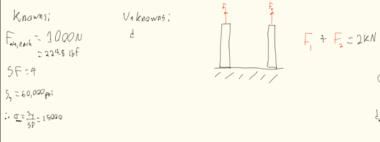

Afterwards we would first find all applicable equations, we would then symbolically solve for our diameter. Once solved symbolically it can be solved numerically, this would leave us with an answer of a minimum diameter of .138 inches.

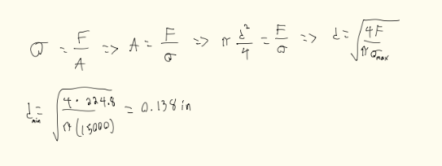

### Lead Screw Rotational Speed 
To begin, based off of the 4140 Black-Oxide Steel lead screw options available from McMaster-Carr, the smallest diameter lead screw which was still above the minimum diameter previously calculated was 0.25in. Thus, rotational speed would be calculated off of this real diameter in order to get a more real value which our system will experience.

Then we needed to find the rotational speed of the lead screw based upon the linear speed of the crossbar stated in the problem. To do this we started with all knowns and unknowns and drew an FBD to go along with it.

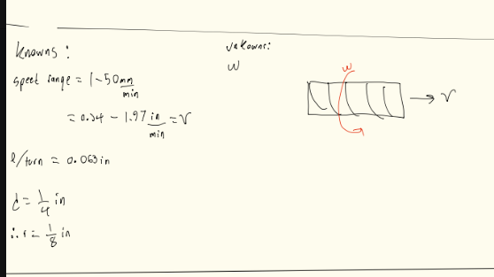

Once all knowns and unknowns are listed we can then find all equations needed to solve for the problem symbolically, after solved symbolically we then solved for it numerically. 

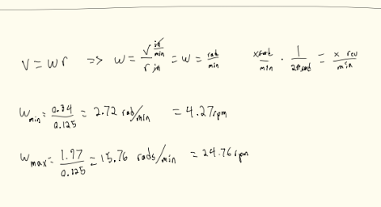

### Lead Screw Torque
To finally pick a lead screw that met all our requirements we lastly needed to solve for out max torque that will be applied on said lead screw. By this point, we had assumed that McMaster-Carr 98940A191 would be sufficient and meet our design requirements. As such, in order to more easily calculate what forces the screw would experience, we decided to use this lead screw in order to eliminate certain variable such as pitch. Then, we listed all knowns and unknowns and drew and FBD. 

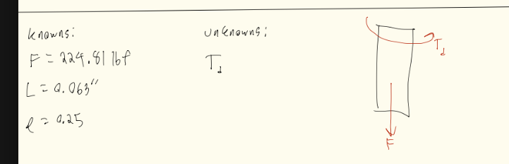

After figuring out our unknowns we know what we must solve for, thankfully solving for this problem symbolically was quite easy as there was a readily avaliable formula within the Machinery's Handbook. We then solved numerically to find a max torque of 9.01 in-lbf. Once all our specifications were calculated we then could select an applicable lead screw off of McMaster-Carr-Carr. We finally landed on a 1/4 inch, Black Oxide, Steel Lead screw. (Part Code - 98940A191)

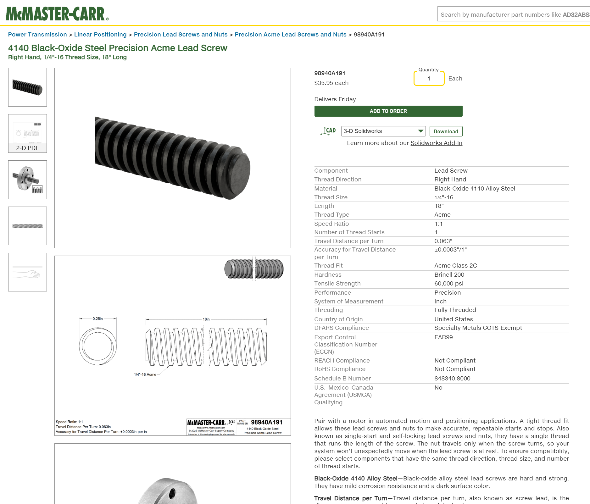

## Nut and Flange Calculations (Zachary Prada)

We then needed to find a proper nut and flange to go along with our lead screw. To select a proper nut and flange we must perform a stress analysis on the threads. As the interior threads had already been decided (based on the thread spec of the lead screw), we would use ACME 1/4"-16 thread in our analysis. To begin, we: listed all knowns and unknowns, solved symbolically, then finally solved numerically to verify that the interior threads of the shortest nut offered by McMaster-Carr would be sufficient.

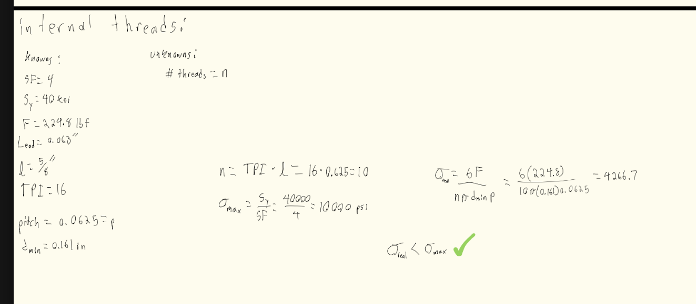

A similar process was followed for verifying the the outer threads for the flange to nut connection, but instead with ACME 9/16"-18 threads.

Once solved, we then found a nut and flange on McMaster-Carr-Carr that would fit our application, and importantly, worked with our lead screw. (Part Code - 95072A881)

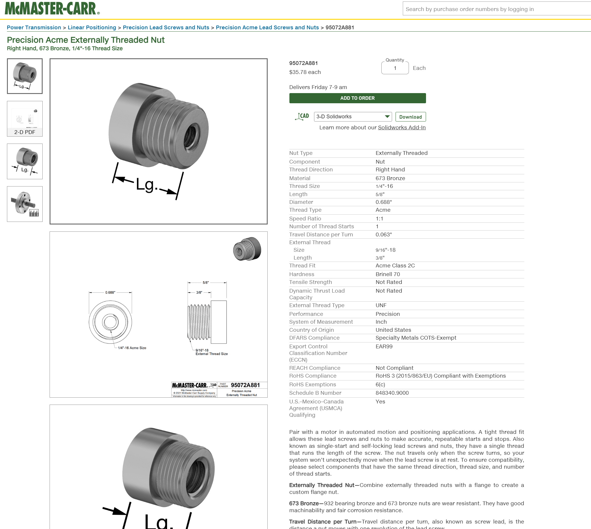

## Crosshead Calculations (Ezra Bono)
### Stress Analysis 
The first thing we must calculate for our crosshead is the max stress applied on the bar, when at a max load of 2kN. We must to this to figure out how thick we must make our bar to not snap under load. Firstly we made a few assumptions, we decided on a square cross-section as it's much easier to calculate and when assembled it less complex to manufacture and assemble. Our second assumption is that our material is ATSM A36 Steel, we choose this material due to wide use already in many applications that involve beams with a point load on them, our second reason for choosing is that it is readily available. The first step we did to solve for the max stress was to list all knowns and unknowns and drew and FBD to go along.

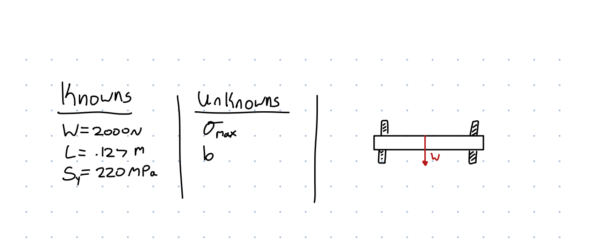

Afterwards we listed all equations and then solved for the side length symbolically, once symbolically solved we then solved for it numerically. Doing so gave us a minimum side length of 31 mm.

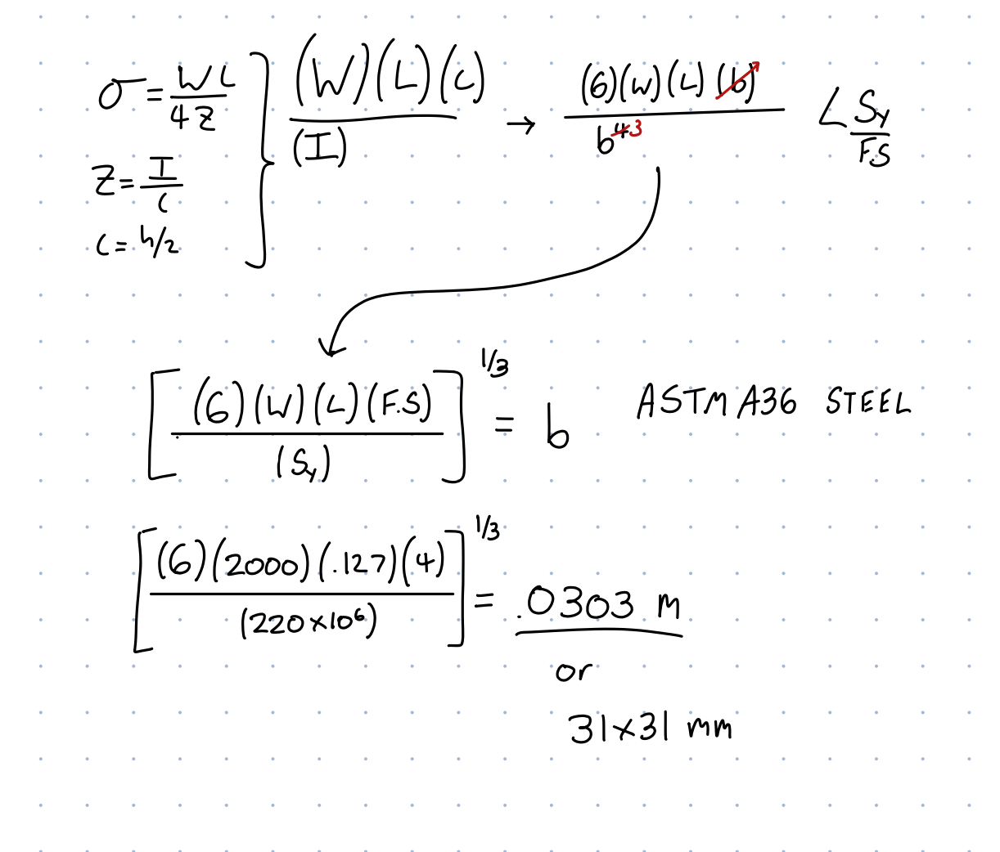

### Deflection Analysis
The next thing to solve for the max deflection on the beam. We were given a hard limit of no more than .1mm deflection. To find the minimum size needed to achieve this we first listed all knowns and unknowns and drew and FBD.

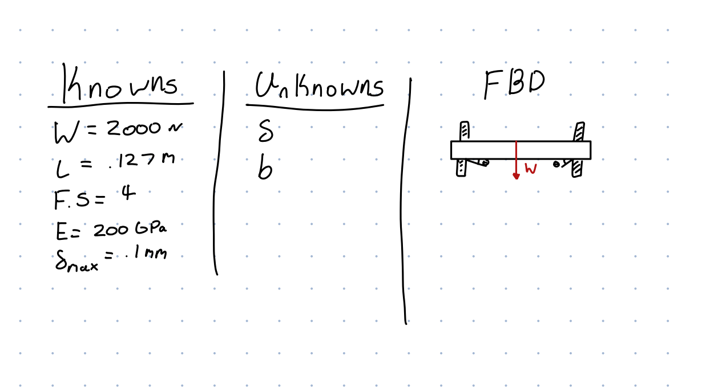

Once all variables were listed, the next step is to list all equations and solve symbolically. Once solved symbolically we solved for side length numerically giving us a final side length of 21.27mm.

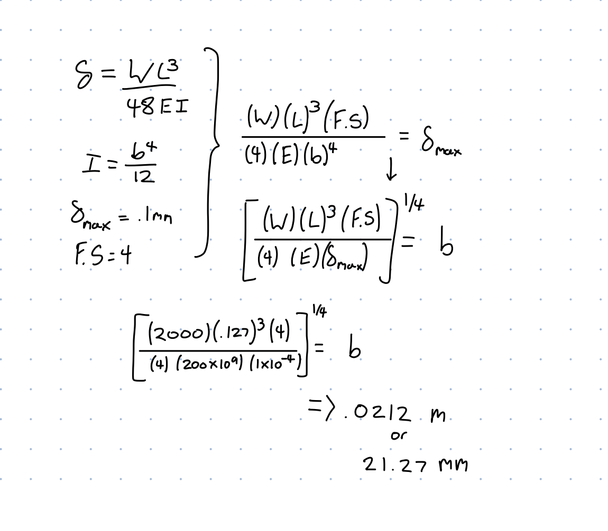

Since our minimum side length of our stress analysis was higher than the minimum side length of our deflection analysis we must use a side length of 31mm or greater. Taking this into account we have a beam that is 127mm long and is 31x31mm wide, two holes are drilled into the bar to fit both of the lead screws, each being at 7.62mm.

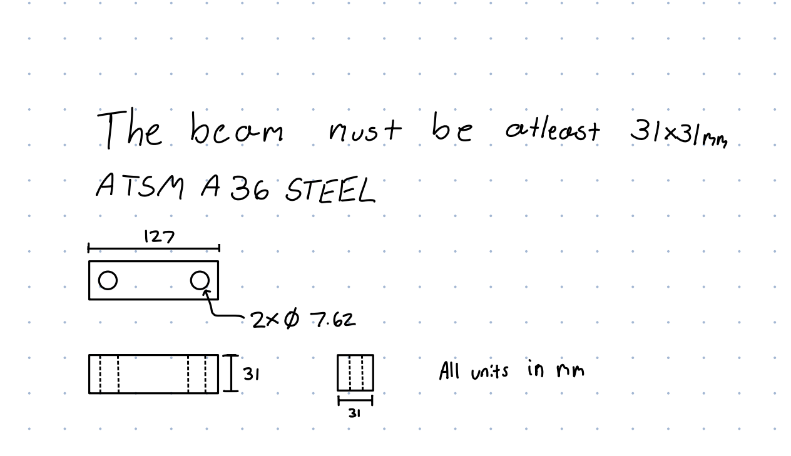

## BOM for complete system (Ezra Bono)

| Part Number | Quantity | Name | Unit Cost | Total Cost |
| :--- | :--- | :--- | :--- | :--- |
| 47065T101 | 4 | [T-Slotted Framing](https://www.McMaster-Carr.com/47065T554) | 11.19 | 44.76 |
| 95082A641 | 2 | [Precision Acme Flange](https://www.McMaster-Carr.com/95082A641) | 37.06 | 74.12 |
| 95072A881 | 2 | [Precision Acme Externally Threaded Nut](https://www.McMaster-Carr.com/95072A881) | 35.78 | 71.56 |
| 98940A191 | 2 | [4140 Black-Oxide Steel Precision Acme Lead Screw](https://www.McMaster-Carr.com/98940A191) | 35.95 | 71.90 |
| **Total** | | | | **262.34** |

## System CAD Model (Zachary Prada)

### Crosshead Design

As the crosshead needed to be designed, we first began by creating a set of variable in SolidWorks based off of previously calculated values. The extra length variable was made to allow for material around the lead screws which would be inserted into the crosshead.

Then, as the cross section of the crosshead was calculated as a square, I created a sketch of a square which had side lengths defined parametrically while also using relationships to keep definitions to a minimum.

Then, using the symmetry of the crosshead, I only extruded one side then would later mirror the features to complete the other.

I then created a point which was defined as the extra length away from the center of the edge, from which I placed and threaded a hole to model the threads with which the lead screw would pass through. 

After all the features on one side were modeled properly, I then mirrored all the features to complete the other side of the crosshead

### Nut and flange sub-assembly

In order to make the final assembly simpler, I chose to have the nut and flange be made into a subasssembly that would then be put into the larger main assembly.

First, using a McMaster-Carr SolidWorks addon, I added in the nut and set its origin to be coincident with the origin of the sub-assembly.

I then imported the cheapest flange which had threads which would fit the chosen nut, and attached it to the nut using mates.

After I had finished with this sub-assembly, I went on to begin the primary assembly

### Main Assembly

First, I imported the crosshead, and set its origin to be coincident with the origin of the assembly, so that I would have a good center to work off of.

I then imported the chosen lead screw, made it concentric with the threads in the crosshead, and set it to be roughly centered with the crosshead so the entire assembly could easily fit on screen.

Then, as the crosshead was symmetrical, I used the mirror component tool across the midplane of the crosshead in order to simply the assembly process.

Then to create the frame. I imported 4 T-slotted frames and aligned them with the lead screws using mates to allow for consistent locations even if things were to move, mirroring vertically using a midpoint plane set between the top and bottom of one of the lead screws, and mirroring horizontally using the assembly's horizontal midplane to again, save on modeling time.

Creating the aforementioned midplane and mirroring the bottom frame.

Importing and placing the vertical frame pieces.

I then imported the previously created nut-flange sub-assembly and made the interior of the threads of the nut concentric with the threads, and placing the flange face on the bottom of the crosshead to better support the crosshead when tensioning a material.

I then repeated the process a other lead screw, importing a copy of the nut-flange sub-assembly.

Completed assembly:

## Reflection (Ezra Bono & Zachary Prada)

An engineering lesson we both learned while working on this project is that playing to others strengths is incredibly beneficial to effeciancy of a project. As Ezra is more experienced with solids, he oversaw the work done in hand calculations, while Zachary is much more experienced in SolidWorks, and thus was in charge of the CAD modeling. With this division of responsibilities, we were more able to more effectively complete the project as a whole, while simultaneously learning skillets from each other.

In total, this assignment took 12 hours to complete.

## 2157 Specific Section (Ezra Bono)

### Splitting faces

The faces were split as shown to better simulate how the crosshead would perform under a real test. The square face is where a clamp to hold the material would be attached, while the 2 circular faces are the flange faces.

### Applying forces and Constraining

The circular faces (supporting flanges) were constrained to act as if they were attached rigidly, and the specified 2000 N force was placed on the square face.

### FEA on initial design

First, we did the most course mesh possible to increase compute speed, and analyzed the simulation to find that the part was well within specified design requirements.

 We then ran the FEA again with a finer mesh to test for convergence.

Using these values, we found that convergence was not reached, as such we ran the FEA one last time with the finest mesh possible.

### Design Alterations & Optimization

As the safety factor was well above the minimum 4 required by the assignment, we chose to alter the design by making the cross sectional area of the crosshead smaller in order to save on material, eyeballing a factor of 1/1.5 derived from guesstimating that we could keep around 2/3rds of the material and still be ok.

After we changed the area, we ran the FEA twice again to test for convergence and to see if the crosshead kept a minimum safety factor of 4.

First run:

Second run:

Calculating the difference in these simulated values, we found that they do not converge to less than 7%, as such we ran the FEA one last time, again at the finest mesh setting allowed by SolidWorks.

At this finest mesh setting, we found that the minimum safety factor was just over 4, right on the line of what is acceptable by the assignment, and thus a design that has been optimized primarily for mass.

Mass before: 3.11 lbs

Mass after: 1.38 lbs

### Crossbeam Drawing

## CAD Files download

[Click Here](https://drive.google.com/file/d/1OajoFGYmqYE4BQru5pYw5TExjGy32nfQ/view?usp=drive_link)
